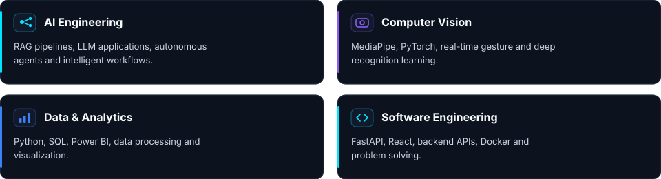
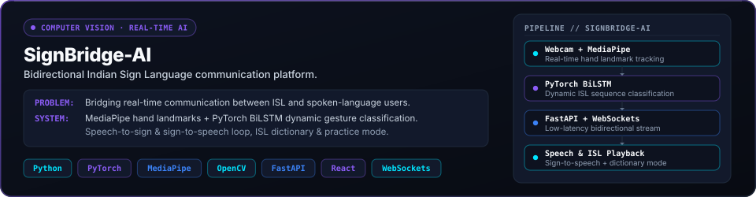
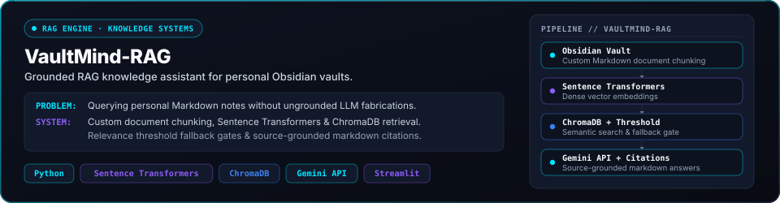
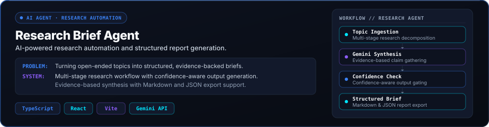
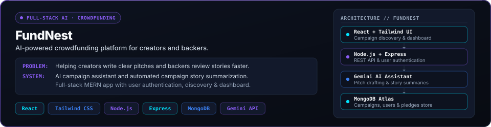
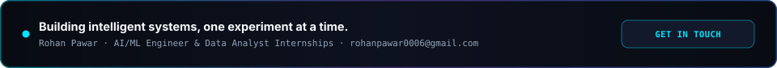

  <!-- ================================================================= -->
  <!-- HERO BANNER                                                       -->
  <!-- ================================================================= -->
  <a href="https://github.com/rohanpawar0006">
    <picture>
      <source media="(prefers-color-scheme: dark)" srcset="assets/hero-dark.svg" />
      <source media="(prefers-color-scheme: light)" srcset="assets/hero-light.svg" />
      
    </picture>
  </a>

   

  <!-- ANIMATED TYPING SUBTITLE -->
  <a href="https://github.com/rohanpawar0006">
    <picture>
      <source media="(prefers-color-scheme: dark)" srcset="https://readme-typing-svg.demolab.com?font=JetBrains+Mono&weight=600&size=18&duration=2600&pause=900&color=00E5FF&center=true&vCenter=true&width=720&height=36&lines=Building+AI+That+Actually+Ships.;Engineering+RAG+%26+Intelligent+Agents.;Computer+Vision+%26+Deep+Learning.;Turning+Data+Into+Decisions.;Building+Full-Stack+AI+Applications." />
      <source media="(prefers-color-scheme: light)" srcset="https://readme-typing-svg.demolab.com?font=JetBrains+Mono&weight=600&size=18&duration=2600&pause=900&color=0284C7&center=true&vCenter=true&width=720&height=36&lines=Building+AI+That+Actually+Ships.;Engineering+RAG+%26+Intelligent+Agents.;Computer+Vision+%26+Deep+Learning.;Turning+Data+Into+Decisions.;Building+Full-Stack+AI+Applications." />
      
    </picture>
  </a>

  <!-- ACTION BUTTONS -->
  

    
    &nbsp;
    
    &nbsp;
    
  

  

    Final-year AI &amp; ML Computer Science undergraduate building grounded RAG systems, real-time computer vision pipelines, and full-stack intelligent applications.
  

 

<!-- ================================================================= -->
<!-- 01. ABOUT ME                                                      -->
<!-- ================================================================= -->
<picture>
  <source media="(prefers-color-scheme: dark)" srcset="assets/section-about-dark.svg" />
  <source media="(prefers-color-scheme: light)" srcset="assets/section-about-light.svg" />
  
</picture>

  

I am **Rohan Pawar**, a final-year B.E. Computer Science student specializing in Artificial Intelligence and Machine Learning at **SVCE**, graduating in **2027**.

My interests span **AI/ML Engineering**, **Computer Vision**, **Retrieval-Augmented Generation (RAG)**, **AI Agents**, **Backend Development**, and **Data Analytics**. I enjoy understanding how intelligent systems work internally and building practical applications that solve real-world problems.

- **Focus:** Turning ML and LLM architectures into reliable, grounded, and usable software.
- **Opportunities:** Actively seeking **AI/ML Engineer**, **AI Engineer**, and **Data Analyst** internship opportunities.

 

  <picture>
    <source media="(prefers-color-scheme: dark)" srcset="assets/divider-dark.svg" />
    <source media="(prefers-color-scheme: light)" srcset="assets/divider-light.svg" />
    
  </picture>

 

<!-- ================================================================= -->
<!-- 02. CURRENT FOCUS                                                 -->
<!-- ================================================================= -->
<picture>
  <source media="(prefers-color-scheme: dark)" srcset="assets/section-focus-dark.svg" />
  <source media="(prefers-color-scheme: light)" srcset="assets/section-focus-light.svg" />
  
</picture>

  

  <picture>
    <source media="(prefers-color-scheme: dark)" srcset="assets/focus-grid-dark.svg" />
    <source media="(prefers-color-scheme: light)" srcset="assets/focus-grid-light.svg" />
    
  </picture>

 

  <picture>
    <source media="(prefers-color-scheme: dark)" srcset="assets/divider-dark.svg" />
    <source media="(prefers-color-scheme: light)" srcset="assets/divider-light.svg" />
    
  </picture>

 

<!-- ================================================================= -->
<!-- 03. FEATURED PROJECTS                                             -->
<!-- ================================================================= -->
<picture>
  <source media="(prefers-color-scheme: dark)" srcset="assets/section-projects-dark.svg" />
  <source media="(prefers-color-scheme: light)" srcset="assets/section-projects-light.svg" />
  
</picture>

  

<!-- PROJECT 1: SIGNBRIDGE-AI -->
<a href="https://github.com/rohanpawar0006/SignBridge-AI">
  <picture>
    <source media="(prefers-color-scheme: dark)" srcset="assets/project-signbridge-dark.svg" />
    <source media="(prefers-color-scheme: light)" srcset="assets/project-signbridge-light.svg" />
    
  </picture>
</a>

  
  &nbsp;
  

  
<b>Architecture &amp; Key Features — SignBridge-AI</b>

  <blockquote>
    
<b>Category:</b> Computer Vision &amp; Real-Time AI

    
<b>Problem:</b> Everyday communication barriers between Indian Sign Language (ISL) users and spoken-language speakers.

    
<b>Key Implementation:</b>

    <ul>
      <li>Real-time ISL gesture recognition using MediaPipe hand landmarks and OpenCV.</li>
      <li>BiLSTM-based dynamic gesture classification in PyTorch.</li>
      <li>Bidirectional speech-to-sign and sign-to-speech communication over FastAPI, React, and WebSockets.</li>
      <li>Interactive ISL dictionary alongside practice and learning functionality.</li>
    </ul>
  </blockquote>

 

<!-- PROJECT 2: VAULTMIND-RAG -->
<a href="https://github.com/rohanpawar0006/vaultmind-rag">
  <picture>
    <source media="(prefers-color-scheme: dark)" srcset="assets/project-vaultmind-dark.svg" />
    <source media="(prefers-color-scheme: light)" srcset="assets/project-vaultmind-light.svg" />
    
  </picture>
</a>

  

  
<b>Architecture &amp; Key Features — VaultMind-RAG</b>

  <blockquote>
    
<b>Category:</b> RAG Engine &amp; Knowledge Systems

    
<b>Problem:</b> Querying personal Obsidian Markdown vaults accurately without ungrounded LLM responses.

    
<b>Key Implementation:</b>

    <ul>
      <li>Custom document chunking pipeline tailored for Markdown notes.</li>
      <li>Semantic vector retrieval using Sentence Transformers and ChromaDB.</li>
      <li>Relevance threshold and fallback mechanisms to prevent unsupported answers.</li>
      <li>Source-grounded responses with Markdown source citations in a Streamlit interface powered by Gemini API.</li>
    </ul>
  </blockquote>

 

<!-- PROJECT 3: RESEARCH BRIEF AGENT -->
<a href="https://github.com/rohanpawar0006/research-brief-agent">
  <picture>
    <source media="(prefers-color-scheme: dark)" srcset="assets/project-researchagent-dark.svg" />
    <source media="(prefers-color-scheme: light)" srcset="assets/project-researchagent-light.svg" />
    
  </picture>
</a>

  

  
<b>Architecture &amp; Key Features — Research Brief Agent</b>

  <blockquote>
    
<b>Category:</b> AI Agent &amp; Research Automation

    
<b>Problem:</b> Producing structured, verifiable research briefs from open-ended topics without fabricated claims.

    
<b>Key Implementation:</b>

    <ul>
      <li>Multi-stage research workflow built with TypeScript, React, Vite, and Gemini API.</li>
      <li>Structured research briefs with confidence-aware output and evidence-based generation.</li>
      <li>Markdown and JSON export for downstream documentation and integration.</li>
    </ul>
  </blockquote>

 

<!-- PROJECT 4: FUNDNEST -->
<a href="https://github.com/rohanpawar0006/FundNest">
  <picture>
    <source media="(prefers-color-scheme: dark)" srcset="assets/project-fundnest-dark.svg" />
    <source media="(prefers-color-scheme: light)" srcset="assets/project-fundnest-light.svg" />
    
  </picture>
</a>

  

  
<b>Architecture &amp; Key Features — FundNest</b>

  <blockquote>
    
<b>Category:</b> Full-Stack AI &amp; Web Platform

    
<b>Problem:</b> Helping campaign creators craft clear pitches while enabling backers to evaluate campaign stories quickly.

    
<b>Key Implementation:</b>

    <ul>
      <li>AI campaign assistant and automated campaign story summarization via Gemini API.</li>
      <li>Full-stack architecture built with React, Tailwind CSS, Node.js, Express, and MongoDB.</li>
      <li>User authentication, campaign discovery, and creator dashboard workflows.</li>
    </ul>
  </blockquote>

 

  <picture>
    <source media="(prefers-color-scheme: dark)" srcset="assets/divider-dark.svg" />
    <source media="(prefers-color-scheme: light)" srcset="assets/divider-light.svg" />
    
  </picture>

 

<!-- ================================================================= -->
<!-- 04. TECHNICAL SKILLS                                              -->
<!-- ================================================================= -->
<picture>
  <source media="(prefers-color-scheme: dark)" srcset="assets/section-skills-dark.svg" />
  <source media="(prefers-color-scheme: light)" srcset="assets/section-skills-light.svg" />
  
</picture>

  

<table>
  <tr>
    <td width="24%"><b>Languages</b></td>
    <td>
      
      
      
      
      
    </td>
  </tr>
  <tr>
    <td><b>AI &amp; Machine Learning</b></td>
    <td>
      
      
      
      
      
      
      
    </td>
  </tr>
  <tr>
    <td><b>AI Engineering</b></td>
    <td>
      
      
      
      
      
      
    </td>
  </tr>
  <tr>
    <td><b>Data Analytics</b></td>
    <td>
      
      
      
      
    </td>
  </tr>
  <tr>
    <td><b>Backend &amp; Development</b></td>
    <td>
      
      
      
      
      
      
      
    </td>
  </tr>
  <tr>
    <td><b>Tools</b></td>
    <td>
      
      
      
      
      
      
      
    </td>
  </tr>
</table>

 

  <picture>
    <source media="(prefers-color-scheme: dark)" srcset="assets/divider-dark.svg" />
    <source media="(prefers-color-scheme: light)" srcset="assets/divider-light.svg" />
    
  </picture>

 

<!-- ================================================================= -->
<!-- 05. PROBLEM SOLVING                                               -->
<!-- ================================================================= -->
<picture>
  <source media="(prefers-color-scheme: dark)" srcset="assets/section-dsa-dark.svg" />
  <source media="(prefers-color-scheme: light)" srcset="assets/section-dsa-light.svg" />
  
</picture>

  

Consistent practice in Data Structures &amp; Algorithms through **LeetCode** and **NeetCode** to sharpen problem-solving clarity and algorithmic fundamentals.

- **Core Patterns:** Arrays, Hash Maps, Sliding Window, Two Pointers, Trees, Graphs, and Dynamic Programming.
- **Solutions Archive:** [`rohanpawar0006/Leetcode-Submissions`](https://github.com/rohanpawar0006/Leetcode-Submissions)

 

  <picture>
    <source media="(prefers-color-scheme: dark)" srcset="assets/divider-dark.svg" />
    <source media="(prefers-color-scheme: light)" srcset="assets/divider-light.svg" />
    
  </picture>

 

<!-- ================================================================= -->
<!-- 06. GITHUB ANALYTICS                                              -->
<!-- ================================================================= -->
<picture>
  <source media="(prefers-color-scheme: dark)" srcset="assets/section-analytics-dark.svg" />
  <source media="(prefers-color-scheme: light)" srcset="assets/section-analytics-light.svg" />
  
</picture>

  

  <!-- GitHub Stats & Most-Used Languages -->
  

    <picture>
      <source media="(prefers-color-scheme: dark)" srcset="https://github-readme-stats.vercel.app/api?username=rohanpawar0006&show_icons=true&bg_color=080B12&title_color=00E5FF&icon_color=8B5CF6&text_color=E2E8F0&border_color=1E293B" />
      <source media="(prefers-color-scheme: light)" srcset="https://github-readme-stats.vercel.app/api?username=rohanpawar0006&show_icons=true&bg_color=FFFFFF&title_color=0284C7&icon_color=7C3AED&text_color=0F172A&border_color=CBD5E1" />
      
    </picture>
    &nbsp;
    <picture>
      <source media="(prefers-color-scheme: dark)" srcset="https://github-readme-stats.vercel.app/api/top-langs/?username=rohanpawar0006&layout=compact&bg_color=080B12&title_color=00E5FF&text_color=E2E8F0&border_color=1E293B" />
      <source media="(prefers-color-scheme: light)" srcset="https://github-readme-stats.vercel.app/api/top-langs/?username=rohanpawar0006&layout=compact&bg_color=FFFFFF&title_color=0284C7&text_color=0F172A&border_color=CBD5E1" />
      
    </picture>
  

  <!-- Contribution Activity Graph -->
  

    <picture>
      <source media="(prefers-color-scheme: dark)" srcset="https://github-readme-activity-graph.vercel.app/graph?username=rohanpawar0006&bg_color=080B12&color=00E5FF&line=8B5CF6&point=00E5FF&area=true&hide_border=false&border_color=1E293B" />
      <source media="(prefers-color-scheme: light)" srcset="https://github-readme-activity-graph.vercel.app/graph?username=rohanpawar0006&bg_color=FFFFFF&color=0284C7&line=7C3AED&point=2563EB&area=true&hide_border=false&border_color=CBD5E1" />
      
    </picture>
  

  <!-- Contribution Snake Animation -->
  

    <picture>
      <source media="(prefers-color-scheme: dark)" srcset="https://raw.githubusercontent.com/rohanpawar0006/rohanpawar0006/output/github-contribution-grid-snake-dark.svg" />
      <source media="(prefers-color-scheme: light)" srcset="https://raw.githubusercontent.com/rohanpawar0006/rohanpawar0006/output/github-contribution-grid-snake.svg" />
      
    </picture>
  

 

  <picture>
    <source media="(prefers-color-scheme: dark)" srcset="assets/divider-dark.svg" />
    <source media="(prefers-color-scheme: light)" srcset="assets/divider-light.svg" />
    
  </picture>

 

<!-- ================================================================= -->
<!-- 07. CONNECT WITH ME                                               -->
<!-- ================================================================= -->
<picture>
  <source media="(prefers-color-scheme: dark)" srcset="assets/section-connect-dark.svg" />
  <source media="(prefers-color-scheme: light)" srcset="assets/section-connect-light.svg" />
  
</picture>

  

  

    Open to <b>AI/ML Engineer</b>, <b>AI Engineer</b>, and <b>Data Analyst</b> internship opportunities, technical collaborations, and engineering discussions.
  

  

    
    &nbsp;&nbsp;
    
    &nbsp;&nbsp;
    
  

   

  <a href="mailto:rohanpawar0006@gmail.com">
    <picture>
      <source media="(prefers-color-scheme: dark)" srcset="assets/footer-dark.svg" />
      <source media="(prefers-color-scheme: light)" srcset="assets/footer-light.svg" />
      
    </picture>
  </a>

